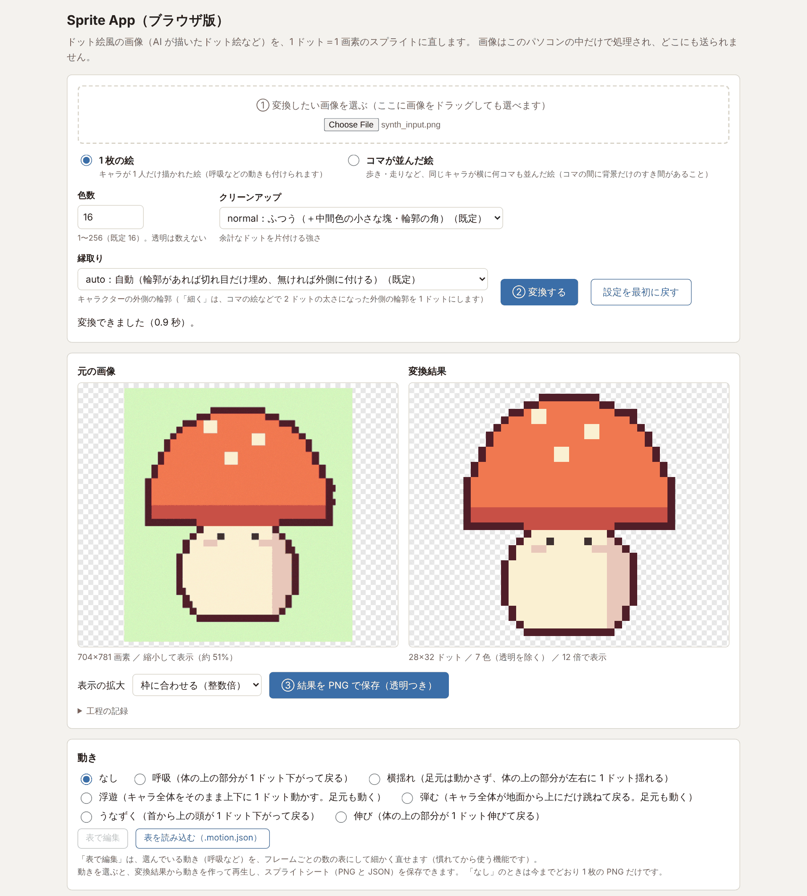

# Sprite App

AI が描いた「ドット絵風の画像」から、本物のドット絵のスプライト（1 ドット＝1 画素・平塗り・少ない色）と、
その動き（呼吸・横揺れ・浮遊・弾む・うなずく・伸び）のスプライトシートを作るアプリです。
横に何コマも並んだ歩き・走りの絵を、1 つのキャラとしてそろえたシートにすることもできます。

- **ブラウザ版**: 1 枚の HTML。インストールもサーバーも要りません。画像はブラウザの外に送られません
- **CLI**: `python -m apps.sprite`。ブラウザ版と同じ Python のコード（`retrocore/sprite/`）で動き、同じ設定なら出力はバイト単位で同じです



## できること

1. **変換**（ドット絵風の画像 → ドット絵）: 背景を消す → ドットの境目（グリッド）を見つけて 1 ドット＝1 画素に戻す → 似た色をまとめる（既定 16 色）
   → 余計なドットを片付ける → 外側の輪郭を整える。普通のイラストを縮小することもできます（`--input-type illust`）
2. **パレット**: 使った色を保存し（`--save-palette`）、次のキャラをその色だけで描く（`--palette`）
3. **動き**: 呼吸・横揺れ・浮遊・弾む・うなずく・伸びのプリセットと、数の表（`.motion.json`）で書く自分の動き。
   新しい色を作らない・足元をそろえる・輪郭を途切れさせない・迷ったら動かさない、を確かめ、作れないときは理由を残します
4. **コマが並んだ絵**（歩き・走りなど）: コマを切り分け、同じグリッド・同じパレット・同じ大きさ・同じ足元にそろえたシートにします。
   何枚かのファイルに分けて描いた長い動き（ダンスなど）を、並べた順につなげて 1 つの動きにもできます（`--join`）。
   立ち・歩き・走り・ジャンプなどに名前を付けて 1 つのシート（1 つの動き = 1 行）にまとめ、JSON の `animations` から Godot などで切り替えられます（`--anims`）。
   ちらつきを減らす・頭などの範囲を 1 コマ目と同じにする・画面の中で数ドットを直す、もできます
5. **書き出し**: スプライトシート（PNG）と情報（JSON）、GIF アニメ、左右反転、Piskel で開ける `.piskel`。
   Piskel などで手直ししたシートを読み戻して作り直すこともできます

詳しい使い方は [apps/sprite/README.md](apps/sprite/README.md)、オプションと出力の形は [docs/cli.md](docs/cli.md)、
仕組みは [docs/how-it-works.md](docs/how-it-works.md)、設計は [docs/sprite-app-plan.md](docs/sprite-app-plan.md)、
手直しの手順は [docs/sprite-edit.md](docs/sprite-edit.md)、これまでの作業のまとめは [docs/history.md](docs/history.md) にあります。

## ブラウザ版の使い方

1. GitHub で [`apps/sprite/web/sprite-app.html`](apps/sprite/web/sprite-app.html) を開き、右上の「Download raw file」（下向きの矢印）を押す
2. ダウンロードした `sprite-app.html` をダブルクリックして、ブラウザ（Chrome・Edge など）で開く
3. 「準備ができました」と出たら（初めては 10〜30 秒。Python の実行環境 Pyodide をインターネットから読み込みます）、
   画像を選んで「② 変換する」→ 下の「保存」の「まとめて保存（ZIP）」（1 つずつ保存するときは「1 つずつ保存」を開く）
4. 動きを付けるときは、画像の選択の下の「動き」で呼吸などを選んでから保存する（ZIP にシートの PNG・JSON・GIF が入る）

入力の種類を「コマが並んだ絵」にすると、歩き・走りのように横に並んだコマをそろえたシートにできます。
色数・縁取りなどのたまに使う設定は「必要なときに開く」「細かい設定」の中に折りたたんであります（詳しくは [apps/sprite/README.md](apps/sprite/README.md)）。
ゲーム（Godot 4）で使うときの設定も [apps/sprite/README.md](apps/sprite/README.md) の「ゲームで使うときの設定（Godot 4）」にあります。

## CLI の使い方

Python 3.10 以上が要ります。

```bash
pip install -r requirements.txt
```

```bash
python -m apps.sprite 入力.png -o out/sprite/出力.png
```

よく使う例です（ほかのオプションは `python -m apps.sprite --help` と [docs/cli.md](docs/cli.md)）。

```bash
python -m apps.sprite 入力.png --motion breathe --gif
```

```bash
python -m apps.sprite 入力.png --input-type illust --scale 1/4 -o out/sprite/出力.png
```

```bash
python -m apps.sprite 入力.png --save-palette game.gpl
```

```bash
python -m apps.sprite 歩き.png --frames --frame-count 4 --frame-order 1,2,3,2 --gif --mirror --piskel
```

```bash
python -m apps.sprite 直した.piskel --readback 元.json --gif --mirror --piskel
```

出力先の `out/` は Git に入りません。手持ちの画像は `local_samples/` に置くと Git に入りません。

## 開発

```bash
pip install -r requirements-dev.txt
```

```bash
python -m pytest
```

`retrocore/` を変えたら、ブラウザ版の HTML を作り直します（古いままだとテストで分かります）。

```bash
python tools/build_sprite_web.py
```

| フォルダ | 中身 |
| --- | --- |
| `retrocore/sprite/` | Sprite App の処理（NumPy と Pillow だけ。ブラウザの Pyodide でも動く） |
| `retrocore/` のほかのファイル | 古いパソコン風の CG 変換（減色・ディザ・解析）。Sprite App からは使っていない |
| `apps/sprite/` | CLI（`cli.py`）とブラウザ版（`web/`）、動きの表の見本（`examples/`） |
| `tools/` | ブラウザ版の HTML を作る `build_sprite_web.py`、比較画像を作る `compare_sprite_*.py` など |
| `tests/` | pytest。テスト画像はすべてコードで合成 |
| `docs/` | 設計（`sprite-app-plan.md`）・仕組み（`how-it-works.md`）・CLI（`cli.md`）・やり残したこと（`TODO.md`）・これまでのまとめ（`history.md`）。昔の記録は `archive/` |

## ライセンス

ライセンスは付けていません。コードを見るのは自由ですが、使う・改造する・配るには作者の許可が要ります。
